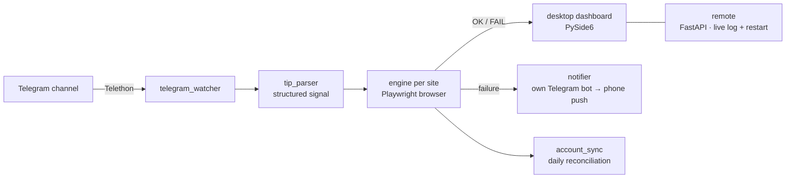

# BetPlacer Standalone

A Windows desktop app that turns messages from a Telegram channel into actions on a website,
without anyone at the keyboard. It listens to a channel, parses each new signal, carries it out
in a real browser session (Playwright), and reports back. If an action fails, you get a push
notification on your phone.

The current integrations are two Hungarian online sportsbooks, so here a "signal" is a betting tip.
The rest of the app (the listener, parser, browser engine, notifications, remote control and
self-updater) doesn't depend on that.

> 🇭🇺 The Hungarian user guide is in [README.hu.md](README.hu.md).

## How it works



1. **Listen.** A Telegram user session (Telethon) watches the configured channel.
2. **Parse.** `tip_parser` turns the free-text message into a structured signal.
3. **Act.** A per-site engine logs in once, keeps the browser session alive, finds the event and
   submits the action.
4. **Report.** Results appear in the dashboard with a colour-coded log. Failures go to your own
   Telegram bot, so they show up as push notifications.
5. **Reconcile.** Every morning `account_sync` compares the app's own log of placed actions with
   the account history on the site, then sends a summary that flags any mismatch.

## Features

- **No-code setup.** `install.bat` installs Python 3.13 if needed (no admin rights) and the
  Chromium browser. A 5-step wizard handles the Telegram login, site credentials, alert bot and
  default amount.
- **Desktop dashboard (PySide6):** status, balances, open items, history, and a separate amount
  for each strategy and each site.
- **Push alerts on failure** through a bot you create yourself. Telegram doesn't push your own
  Saved Messages to your phone, but it does push messages from a bot.
- **Remote control from your phone:** a mobile web page with a live log and a Restart button,
  served over a private Tailscale network and protected by a generated token. No open ports.
- **Stays awake.** While it runs, the app keeps Windows from sleeping
  (`SetThreadExecutionState`). The display can still turn off.
- **Self-updating** from GitHub Releases. The Update button downloads the new version and swaps
  it in, keeping user data.
- **Dry-run mode** (`--dry-run`) runs the whole pipeline without submitting anything.

## Quick start

Requires Windows 10/11.

```bat
install.bat          :: one-time: Python, packages, Chromium (~5–15 min)
run.bat              :: start the app; the setup wizard opens on first run
```

Command-line options:

```bash
python main.py               # GUI (same as run.bat)
python main.py --stake 1000  # override the amount for this run
python main.py --dry-run     # test mode, submits nothing
python main.py --setup       # re-run the setup wizard
python main.py --no-gui      # console only
```

Optional `.env` settings for remote control:

```
RIM_REMOTE_PORT=8765       # preferred port (moves to the next free one if taken)
RIM_REMOTE_ENABLED=false   # turn remote control off
RIM_REMOTE_TOKEN=...       # access token (generated on first run)
```

## Project layout

```
main.py / launcher.py   entry points
gui.py, main_view.py    desktop UI (PySide6 + qt-material)
setup_wizard.py         first-run wizard
telegram_watcher.py     channel listener (Telethon)
tip_parser.py           message → structured signal
betplacer_core.py       run loop, sleep prevention, orchestration
bet_engine.py           site engine #1 (Playwright)
vegas_engine.py         site engine #2 (Playwright)
account_sync.py         daily reconciliation report
stake_store.py          amount per strategy and site
dashboard_state.py      state shared between the core and the UI
notifier.py             alert bot
remote/                 FastAPI server + mobile page
updater.py              GitHub Releases self-updater
```

## Stack

Python · Playwright · Telethon · PySide6 · FastAPI/uvicorn · Tailscale · GitHub Releases

## Security

`.env` and `telegram_session.session` hold personal credentials. They are created locally, are
git-ignored, and should never be shared.
